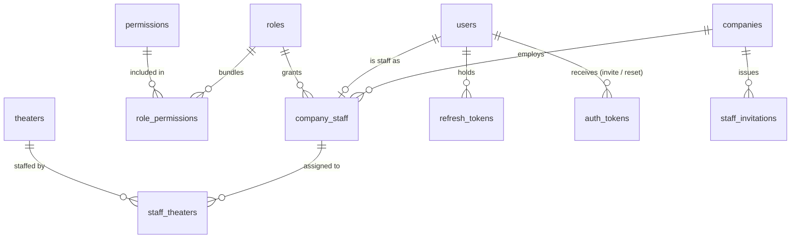
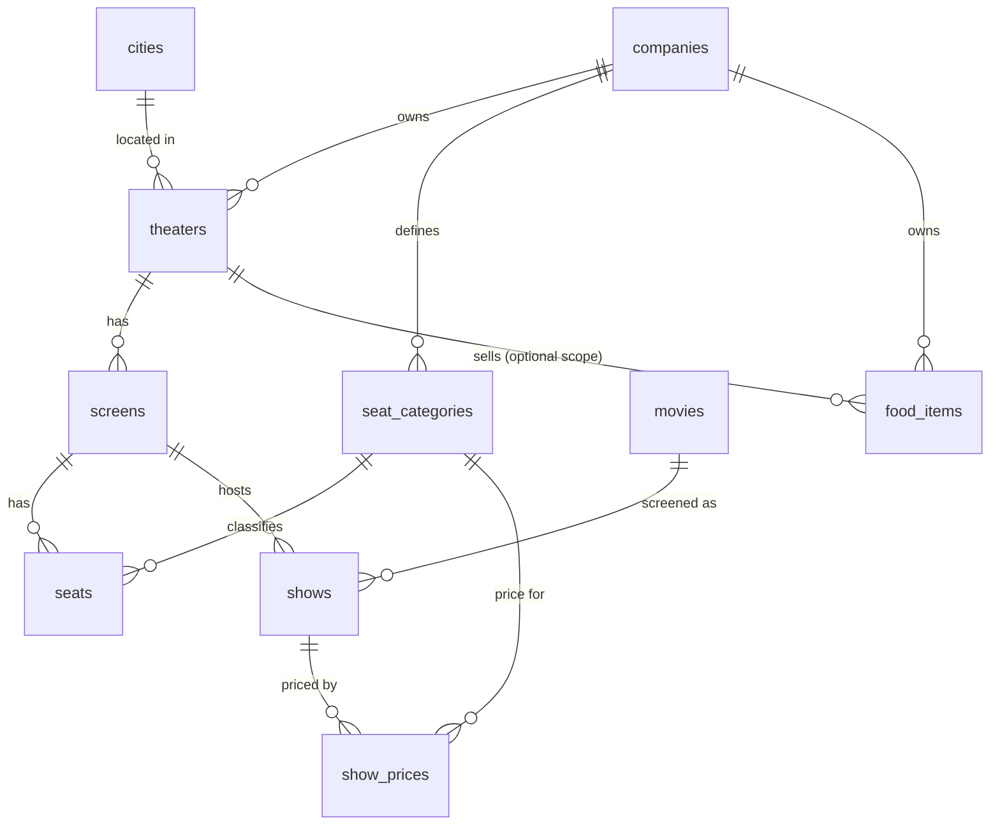
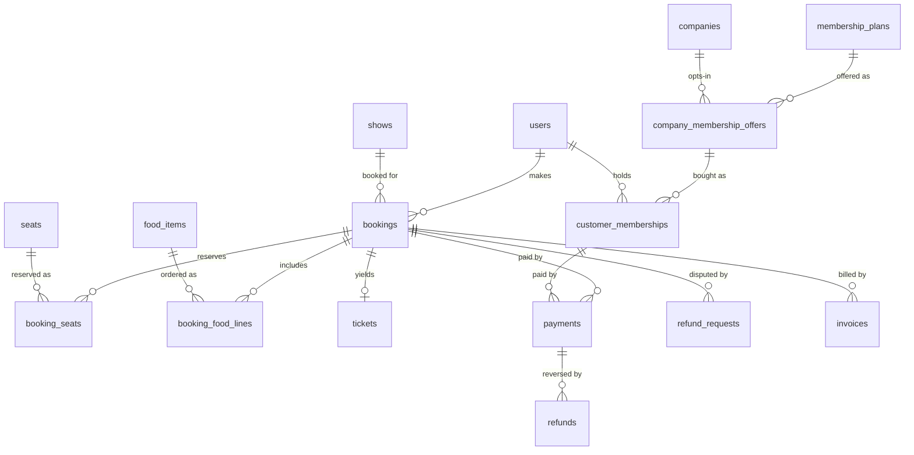
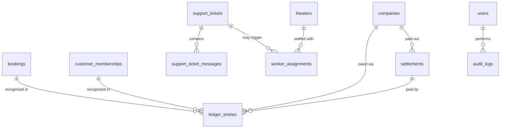

# Book My Ticket — Database Design

PostgreSQL 17 · Prisma 7 · Status: **approved; DDL verified on Postgres 17** (Prisma schema not written yet, it starts in milestone 1)

Read [project-architecture](../project-architecture/project-architecture.md) first for the big picture and [system-design](../system-design/system-design.md) for *why* the schema looks like this (seat holds, ledger, outbox).

## 1. Design principles

| # | Principle | Why |
| --- | --- | --- |
| 1 | **The database enforces the rules that must never break**: seat sold once, no overlapping shows, no overlapping memberships, immutable money records | Application bugs and race conditions cannot corrupt these; they are constraints, not `if` statements |
| 2 | **Money is an integer in minor units (paise)**, rates are integer **basis points** (1 bps = 0.01%; 10% = `1000`) | No floating point or `Decimal` rounding surprises. Rounding is done in one place (`common/money`) |
| 3 | **Snapshot, never join, for historical money**: price, discount, tax rate and commission rate are copied onto the booking | Spec rule: later changes never alter past bookings |
| 4 | **Money records are append-only** (`ledger_entries`, `refunds`, `payments`, `audit_logs`); a DB trigger rejects `UPDATE`/`DELETE` on ledger and audit tables | Spec rule: "money records are never edited" |
| 5 | **Every tenant-owned row carries `company_id`**, and parent/child pairs use composite FKs `(company_id, id)` | A child row can never point to a parent in another company, even if app code has a bug |
| 6 | **UUID v7 primary keys** (`@default(uuid(7))`), generated by Prisma | Time-ordered, so index inserts stay local; safe to expose in URLs; no enumeration |
| 7 | **`timestamptz(3)` everywhere**, always UTC. `created_at` and `updated_at` on every mutable table | Show times are instants; the client formats in the theater's city timezone (India-only v1, `Asia/Kolkata`) |
| 8 | **Soft delete only for catalog-like data** (`deleted_at` on movies, theaters, screens, food items). Never for bookings, money or audit | Keeps history readable without poisoning unique indexes (partial uniques use `WHERE deleted_at IS NULL`) |
| 9 | **Naming**: tables `snake_case` plural, columns `snake_case`, Prisma models `PascalCase` with `@@map` / `@map` | DB stays idiomatic SQL; code stays idiomatic TypeScript |
| 10 | **Prisma `enum`s** for closed sets that change rarely (states); lookup **tables** for sets that data owners edit (cities, seat categories, tax rates, permissions) | Adding a PG enum value needs a migration; rows do not |

### Verification record

The schema in section 4 plus the constraints in section 6 were turned into DDL and run against Postgres 17 in a throwaway database (since dropped). Result: all 38 relations created and 22 behavioural checks passed:

| Checked | Result |
| --- | --- |
| Composite tenant FKs reject a child under another company's parent (screens, seats) | pass |
| Show overlap rejected; back-to-back allowed; cancelled show frees the slot | pass |
| Booking total `CHECK`; one pending booking per customer per show | pass |
| Seat claim: expired hold on the same seat is released and re-claimed in one transaction; live holds are never released | pass |
| Overlapping active membership rejected | pass |
| Ledger and audit `UPDATE`/`DELETE` blocked; recognition idempotent; `ADJUSTMENT` needs memo; payable balance after a settlement | pass |
| Payment kind/FK `CHECK` | pass |
| **Concurrency, real sessions**: 20 parallel claims on one seat → exactly 1 winner, 19 get zero rows; a late claimer blocks until the first transaction commits, then gets zero rows | pass |

One bug found and fixed in the design: a plain `UNIQUE (company_id, name)` on `roles` cannot protect system roles (NULL company); two partial indexes are used instead. The DDL and tests are not in the repo; the real migration is produced in milestone 1 and must keep every check above as an integration test.

## 2. Entity map

Four areas, matching the domain spec. Each diagram shows keys only; columns are in section 4.

### 2.1 Identity and tenancy



### 2.2 Venue, catalog and shows



### 2.3 Customer purchases



### 2.4 Money, support and oversight



## 3. Enumerations

| Enum | Values |
| --- | --- |
| `UserKind` | `SUPER_ADMIN`, `STAFF`, `CLIENT` |
| `UserStatus` | `INVITED`, `ACTIVE`, `DISABLED` |
| `CompanyStatus` | `ACTIVE`, `SUSPENDED` |
| `ShowStatus` | `SCHEDULED`, `CANCELLED`, `COMPLETED` |
| `BookingStatus` | `PENDING`, `CONFIRMED`, `EXPIRED`, `CANCELLED`, `COMPLETED` |
| `SeatHoldStatus` | `HELD`, `SOLD`, `RELEASED` |
| `FoodSlot` | `PRE_INTERVAL`, `POST_INTERVAL` |
| `TicketStatus` | `ISSUED`, `USED`, `VOID` |
| `PaymentKind` | `BOOKING`, `MEMBERSHIP` |
| `PaymentStatus` | `INITIATED`, `SUCCEEDED`, `FAILED` |
| `RefundStatus` | `PENDING`, `SUCCEEDED`, `FAILED` |
| `RefundRequestStatus` | `REQUESTED`, `APPROVED`, `REJECTED`, `REFUNDED` |
| `MembershipStatus` | `PENDING`, `ACTIVE`, `FAILED` (expiry is derived from `ends_at`, never stored) |
| `TaxItemType` | `TICKET`, `FOOD`, `MEMBERSHIP` |
| `LedgerAccount` | `COMPANY_PAYABLE`, `PLATFORM_INCOME` |
| `LedgerEntryType` | `TICKET_PAYOUT`, `TICKET_COMMISSION`, `FOOD_PAYOUT`, `FOOD_COMMISSION`, `MEMBERSHIP_PAYOUT`, `MEMBERSHIP_COMMISSION`, `REGISTRATION_FEE`, `SETTLEMENT`, `ADJUSTMENT` |
| `SupportTicketType` | `HELP`, `MAINTENANCE`, `PLATFORM_REQUEST` |
| `SupportTicketStatus` | `OPEN`, `IN_PROGRESS`, `RESOLVED`, `CLOSED` |
| `WorkerRole` | `GATE`, `MAINTENANCE` |

## 4. Tables

Legend: **PK** primary key · **FK** foreign key · **U** unique · types are Postgres types. Every table also has `created_at timestamptz` (and `updated_at` unless it is append-only); they are omitted below.

### 4.1 Identity and tenancy

**`users`** — every human with a login (super admin, staff, customers).

| Column | Type | Notes |
| --- | --- | --- |
| `id` | uuid PK | |
| `kind` | `UserKind` | Never changes after creation |
| `email` | `citext` U | Case-insensitive unique (`citext` extension) |
| `password_hash` | text null | argon2id; null while `INVITED` |
| `full_name` | text | |
| `phone` | text null | |
| `status` | `UserStatus` | |
| `last_login_at` | timestamptz null | |

**`companies`** — the tenant.

| Column | Type | Notes |
| --- | --- | --- |
| `id` | uuid PK | |
| `name` | text | |
| `slug` | text U | |
| `status` | `CompanyStatus` | `SUSPENDED` hides theaters from the client app |
| `sales_commission_bps` | int | CHECK 0–10000. Applies to **tickets and food**, on the pre-tax amount |
| `membership_commission_bps` | int | CHECK 0–10000 |
| `registration_fee` | int | Paise; collected offline |
| `registration_fee_paid_at` | timestamptz null | |
| `cancellation_policy` | text | Shown to customers before booking |
| `refund_policy` | text | |
| `onboarded_by` | uuid FK users | The super admin |

**`company_staff`** — links a `STAFF` user to exactly one company and one role.

| Column | Type | Notes |
| --- | --- | --- |
| `id` | uuid PK | |
| `company_id` | uuid FK | |
| `user_id` | uuid FK U | One company per staff user |
| `role_id` | uuid FK roles | |
| `is_owner` | bool | Partial unique: one owner per company (`WHERE is_owner`) |
| `deactivated_at` | timestamptz null | |

**`staff_theaters`** — which theaters a staff member may act on. PK `(staff_id, theater_id)`. Owners ignore this table (all theaters); maintenance staff are limited to rows here.

**`roles`** · **`permissions`** · **`role_permissions`** — RBAC.

| Table | Columns |
| --- | --- |
| `permissions` | `id`, `code` U (e.g. `show.create`), `description`. Seeded from the `Permission` constant in code; a boot check fails if code and table disagree |
| `roles` | `id`, `name`, `company_id` null (null = system role), `is_system` bool. Two partial uniques, because NULLs are distinct in a plain unique index: `(company_id, name) WHERE company_id IS NOT NULL` and `(name) WHERE company_id IS NULL` |
| `role_permissions` | PK `(role_id, permission_id)` |

Seeded system roles: `COMPANY_OWNER` (all company-level permissions), `MAINTENANCE_STAFF`. The super admin needs no role: `users.kind = SUPER_ADMIN` bypasses permission checks for platform routes only. Company-defined roles are possible later with no schema change (`company_id` is already there).

**`staff_invitations`** — owner invites staff by email.

| Column | Type | Notes |
| --- | --- | --- |
| `id` | uuid PK | |
| `company_id` | uuid FK | |
| `email` | citext | |
| `role_id` | uuid FK | |
| `theater_ids` | uuid[] | Applied to `staff_theaters` on acceptance |
| `token_hash` | text U | SHA-256 of the emailed token; raw token never stored |
| `expires_at` / `accepted_at` / `invited_by` | | |

**`auth_tokens`** — one-time tokens for password setup (new company owner) and reset. `id`, `user_id`, `purpose` (`SET_PASSWORD`, `RESET_PASSWORD`), `token_hash` U, `expires_at`, `used_at`.

**`refresh_tokens`** — rotating refresh tokens with reuse detection.

| Column | Type | Notes |
| --- | --- | --- |
| `id` | uuid PK | |
| `user_id` | uuid FK | |
| `family_id` | uuid | One login session = one family |
| `token_hash` | text U | |
| `expires_at` / `revoked_at` / `replaced_by` | | Presenting a revoked token revokes the whole family |

### 4.2 Venue and catalog

**`cities`** — `id`, `name`, `state`, `is_active`. U `(name, state)`. The client app lists only cities that have an active theater (query, not a column).

**`theaters`**

| Column | Type | Notes |
| --- | --- | --- |
| `id` | uuid PK | |
| `company_id` | uuid FK | |
| `city_id` | uuid FK | |
| `name`, `address`, `pincode` | text | |
| `deleted_at` | timestamptz null | |
| | | **U `(company_id, id)`** — target for composite FKs |

**`screens`** — `id`, `company_id`, `theater_id`, `name`, `deleted_at`. FK `(company_id, theater_id)` → `theaters(company_id, id)`. U `(company_id, id)`. Partial U `(theater_id, name) WHERE deleted_at IS NULL`.

**`seat_categories`** — company-level price tiers: `id`, `company_id`, `name` (Silver, Gold, Recliner…), `sort_order`. U `(company_id, name)`; U `(company_id, id)`.

**`seats`** — the physical layout of a screen.

| Column | Type | Notes |
| --- | --- | --- |
| `id` | uuid PK | |
| `company_id` | uuid | |
| `screen_id` | uuid | FK `(company_id, screen_id)` → `screens` |
| `seat_category_id` | uuid | FK `(company_id, seat_category_id)` → `seat_categories` |
| `row_label` | text | `A`, `B`… |
| `seat_number` | int | Number shown to the customer |
| `col_index` | int | Grid column, so aisles render as gaps |
| `is_active` | bool | Broken seats are deactivated, not deleted; existing bookings keep their reference |
| | | U `(screen_id, row_label, seat_number)` |

**`movies`** — global catalog, super-admin owned: `id`, `title`, `description`, `duration_minutes` int, `language`, `certification`, `genres` text[], `release_date`, `poster_key` text null (MinIO object key, later), `deleted_at`. Index: `GIN (genres)`; `title` trigram index for search (`pg_trgm`).

**`shows`** — one screening.

| Column | Type | Notes |
| --- | --- | --- |
| `id` | uuid PK | |
| `company_id` | uuid | |
| `screen_id` | uuid | FK `(company_id, screen_id)` → `screens` |
| `movie_id` | uuid FK | |
| `starts_at` | timestamptz | |
| `interval_offset_minutes` | int | Minutes after `starts_at` when the interval begins; defines pre/post-interval food slots |
| `interval_duration_minutes` | int | |
| `ends_at` | timestamptz | **Computed by the service** = start + movie duration + interval duration (+ cleaning buffer from config). Stored so the overlap constraint and completion sweeper can use it |
| `status` | `ShowStatus` | |
| | | U `(company_id, id)` |

Overlap rule enforced by an exclusion constraint (hand-written SQL, section 6):
`EXCLUDE USING gist (screen_id WITH =, tstzrange(starts_at, ends_at) WITH &&) WHERE (status <> 'CANCELLED')`

**`show_prices`** — `show_id`, `seat_category_id`, `price` int (paise). PK `(show_id, seat_category_id)`. The service verifies a price exists for every category in the screen before a show can be saved.

**`food_items`** — `id`, `company_id`, `theater_id` null (null = all theaters of the company), `name`, `price` int, `is_available`, `deleted_at`.

### 4.3 Booking, tickets, payments

**`bookings`** — the aggregate root of a purchase. Price columns are all snapshots. Only the membership discount exists in v1 and it applies to seats only.

| Column | Type | Notes |
| --- | --- | --- |
| `id` | uuid PK | |
| `reference` | text U | Human-friendly (`BMT-7K3Q9X`), shown on tickets and invoices |
| `company_id` | uuid | Denormalized from the show |
| `show_id` | uuid | FK `(company_id, show_id)` → `shows` |
| `customer_id` | uuid FK users | |
| `status` | `BookingStatus` | |
| `held_until` | timestamptz | `created_at + 10 min`; only meaningful while `PENDING` |
| `customer_membership_id` | uuid null FK | Membership used for the discount |
| `discount_bps` | int | Snapshot of the membership discount (0 if none) |
| `commission_bps` | int | Snapshot of `companies.sales_commission_bps` (tickets and food) |
| `seats_subtotal` | int | Σ seat list price |
| `discount_amount` | int | Applied to seats only |
| `food_subtotal` | int | |
| `tax_amount` | int | Σ line taxes |
| `total_amount` | int | `seats_subtotal − discount_amount + food_subtotal + tax_amount` (CHECK) |
| `paid_amount` | int | Set when payment succeeds |
| `refunded_amount` | int | Denormalized sum of successful `refunds`; updated in the same transaction (CHECK `<= paid_amount`) |
| `ledger_recognised_at` | timestamptz null | Set once the company's share and platform commission are written to the ledger. Makes the completion job idempotent |
| `confirmed_at`, `cancelled_at`, `completed_at` | timestamptz null | |
| `cancel_reason` | text null | |

Constraints: `CHECK (total_amount >= 0)`; partial U `(customer_id, show_id) WHERE status = 'PENDING'` (one open checkout per customer per show — stops a user from locking half a theater with parallel carts).

**`booking_seats`** — the inventory table. **This is where "a seat is sold once per show" is enforced.**

| Column | Type | Notes |
| --- | --- | --- |
| `id` | uuid PK | |
| `booking_id` | uuid FK | |
| `show_id` | uuid | Denormalized so the unique index needs no join |
| `seat_id` | uuid FK | |
| `seat_category_id` | uuid | Snapshot |
| `status` | `SeatHoldStatus` | `HELD` → `SOLD` → (`RELEASED`) |
| `held_until` | timestamptz | Copy of the booking's value, used by the claim query |
| `unit_price` | int | Snapshot |
| `discount_amount` | int | |
| `tax_rate_bps` | int | Snapshot of the TICKET rate |
| `tax_amount` | int | |

```sql
CREATE UNIQUE INDEX booking_seats_one_active_per_show_seat
  ON booking_seats (show_id, seat_id)
  WHERE status IN ('HELD', 'SOLD');
```

No rows exist for unsold seats, so storage grows with sales, not with `shows × seats`.

**`booking_food_lines`** — `id`, `booking_id`, `food_item_id`, `name` (snapshot), `quantity` (CHECK > 0), `unit_price`, `slot` (`FoodSlot`), `tax_rate_bps`, `tax_amount`.

**`tickets`** — one per confirmed booking.

| Column | Type | Notes |
| --- | --- | --- |
| `id` | uuid PK | |
| `booking_id` | uuid U FK | |
| `status` | `TicketStatus` | |
| `qr_payload` | text | Compact signed token (see system design, section 6) |
| `used_at` | timestamptz null | |
| `used_by_employee_id` | text null | Gate worker, ID only |

**`payments`** — one row per gateway attempt.

| Column | Type | Notes |
| --- | --- | --- |
| `id` | uuid PK | |
| `kind` | `PaymentKind` | |
| `booking_id` | uuid null FK | |
| `customer_membership_id` | uuid null FK | |
| `customer_id` | uuid FK | |
| `amount` | int | |
| `currency` | char(3) | `INR` in v1 |
| `provider` | text | `mock`, `razorpay`, `stripe` |
| `provider_ref` | text | Gateway order / intent id. U `(provider, provider_ref)` |
| `status` | `PaymentStatus` | |
| `failure_reason` | text null | |

`CHECK ((kind = 'BOOKING' AND booking_id IS NOT NULL AND customer_membership_id IS NULL) OR (kind = 'MEMBERSHIP' AND customer_membership_id IS NOT NULL AND booking_id IS NULL))`.

**`payment_webhook_events`** — the idempotent inbox. `id`, `provider`, `event_id`, `type`, `payload` jsonb, `received_at`, `processed_at` null. U `(provider, event_id)`: a replayed webhook is a no-op.

**`refunds`** — append-only; one row per gateway refund. `id`, `payment_id`, `refund_request_id` null (null for show-cancellation refunds), `amount`, `status`, `provider_ref`, `failure_reason`.

**`refund_requests`**

| Column | Type | Notes |
| --- | --- | --- |
| `id` | uuid PK | |
| `booking_id` | uuid FK | Partial U `WHERE status IN ('REQUESTED','APPROVED')`: one open request per booking |
| `requested_by` | uuid FK users | |
| `reason` | text | |
| `status` | `RefundRequestStatus` | |
| `approved_amount` | int null | CHECK `<= bookings.paid_amount − refunded_amount`, enforced in the service inside the transaction |
| `decided_by` | uuid null FK users | |
| `decision_note` | text null | |
| `decided_at` | timestamptz null | |

**`invoices`** (v1 mocked) — `id`, `number` U (from a Postgres sequence, `INV-2026-000123`), `booking_id` null, `customer_membership_id` null, `issued_at`. The PDF is rendered on demand from the booking snapshot; no file is stored. Replacing this with GST-compliant invoicing later changes the renderer, not the schema.

### 4.4 Memberships and tax

**`membership_plans`** — platform templates: `id`, `name`, `duration_days`, `discount_bps`, `benefits` text, `suggested_price`, `is_active`.

**`company_membership_offers`** — `id`, `company_id`, `plan_id`, `price`, `is_active`. U `(company_id, plan_id)`. Opting out sets `is_active = false`; existing `customer_memberships` are untouched.

**`customer_memberships`**

| Column | Type | Notes |
| --- | --- | --- |
| `id` | uuid PK | |
| `customer_id` | uuid FK | |
| `company_id` | uuid FK | |
| `offer_id` | uuid FK | |
| `status` | `MembershipStatus` | `PENDING` until payment succeeds |
| `starts_at` / `ends_at` | timestamptz null | Set on activation |
| `discount_bps` | int | Snapshot of the plan |
| `price_paid`, `tax_amount` | int | Snapshots |
| `membership_commission_bps` | int | Snapshot |
| `ledger_recognised_at` | timestamptz null | Same idempotency role as on bookings |

```sql
ALTER TABLE customer_memberships ADD CONSTRAINT customer_memberships_no_overlap
  EXCLUDE USING gist (customer_id WITH =, company_id WITH =, tstzrange(starts_at, ends_at) WITH &&)
  WHERE (status = 'ACTIVE');
```

A customer can hold memberships with many companies but at most one active membership per company at a time.

**`tax_rates`** — `id`, `item_type`, `rate_bps`, `effective_from`, `created_by`. U `(item_type, effective_from)`. The current rate is the row with the greatest `effective_from <= now()`. Rows are never edited; a new rate is a new row.

### 4.5 Money

**`ledger_entries`** — append-only. The only source of truth for what the platform owes companies and what it has earned.

| Column | Type | Notes |
| --- | --- | --- |
| `id` | uuid PK | |
| `account` | `LedgerAccount` | |
| `company_id` | uuid FK | Always set. Platform income is also tagged with the company that produced it (commission, registration fee), so income can be reported per company |
| `entry_type` | `LedgerEntryType` | |
| `amount` | int | **Signed.** Positive increases the account; a settlement is negative on `COMPANY_PAYABLE` |
| `booking_id` / `customer_membership_id` / `settlement_id` | uuid null | Exactly the one that caused the entry |
| `memo` | text null | Required for `ADJUSTMENT` |
| `created_by` | uuid null FK | Null when created by the system |

Idempotency: partial U `(booking_id, entry_type) WHERE booking_id IS NOT NULL` and the same for `customer_membership_id`; running the completion job twice cannot double-count.

Balance of a company: `SELECT COALESCE(SUM(amount),0) FROM ledger_entries WHERE company_id = $1 AND account = 'COMPANY_PAYABLE'` (also exposed as the view `company_payable_balances`).

**`settlements`** — a manual payout: `id`, `company_id`, `amount` (> 0), `period_start`, `period_end`, `bank_reference` U, `paid_at`, `recorded_by`, `note`. Creating one writes a negative `SETTLEMENT` ledger entry in the same transaction, after locking the company row (see 7.4).

### 4.6 Support, workers, audit, plumbing

**`support_tickets`**

| Column | Type | Notes |
| --- | --- | --- |
| `id` | uuid PK | |
| `type` | `SupportTicketType` | Determines routing |
| `company_id` | uuid null FK | Always set; platform requests carry the requesting company |
| `theater_id` | uuid null | Routes help and maintenance tickets to staff assigned to that theater |
| `booking_id` | uuid null FK | Help tickets about a booking |
| `raised_by` | uuid FK users | |
| `assigned_to` | uuid null FK users | |
| `status` | `SupportTicketStatus` | |
| `subject`, `description` | text | |
| `resolved_at` | timestamptz null | |

**`support_ticket_messages`** — `id`, `ticket_id`, `author_id`, `body`.

**`worker_assignments`** — gate/maintenance workers by employee ID only: `id`, `company_id`, `theater_id`, `employee_id` text, `role` (`WorkerRole`), `assigned_at`, `released_at` null, `actioned_by` FK users, `support_ticket_id` null. Partial U `(theater_id, employee_id, role) WHERE released_at IS NULL`.

**`audit_logs`** — append-only. `id`, `occurred_at`, `actor_id` null, `actor_kind`, `company_id` null, `module` text, `action` text, `entity_type`, `entity_id`, `before` jsonb null, `after` jsonb null, `correlation_id`, `ip` inet null. Monthly range-partition by `occurred_at` is planned once volume warrants (not in v1).

**`outbox_events`** — transactional outbox (see system design 5). `id`, `type`, `aggregate_id`, `payload` jsonb, `created_at`, `available_at`, `processed_at` null, `attempts` int. Partial index `(available_at) WHERE processed_at IS NULL`.

**`idempotency_keys`** — `key` + `user_id` PK, `request_hash`, `response_status`, `response_body` jsonb, `expires_at`. Cleaned by a daily job.

## 5. Indexes

Rule used: an index exists only if a documented query in section 7 (or an FK that is joined/deleted by) needs it. FK columns used in joins get an index; Postgres does not create them automatically.

| Table | Index | Serves |
| --- | --- | --- |
| `theaters` | `(city_id) WHERE deleted_at IS NULL` | Client: theaters in a city |
| `theaters` | `(company_id)` | Admin lists |
| `shows` | `(screen_id, starts_at)` | Overlap check, screen schedule (the GiST exclusion index also covers overlap) |
| `shows` | `(movie_id, starts_at) WHERE status = 'SCHEDULED'` | Client: shows for a movie |
| `shows` | `(ends_at) WHERE status = 'SCHEDULED'` | Completion sweeper |
| `shows` | `(company_id, starts_at DESC)` | Admin show list, reports |
| `seats` | `(screen_id)` | Seat map |
| `booking_seats` | unique partial `(show_id, seat_id) WHERE status IN ('HELD','SOLD')` | Seat map, claim, conflict detection |
| `booking_seats` | `(booking_id)` | Load a booking |
| `booking_seats` | `(held_until) WHERE status = 'HELD'` | Expiry sweeper |
| `bookings` | `(customer_id, created_at DESC)` | "My orders" (keyset pagination) |
| `bookings` | `(company_id, show_id)` | Admin booking list per show |
| `bookings` | `(show_id) WHERE status IN ('COMPLETED','CANCELLED') AND ledger_recognised_at IS NULL` | Ledger recognition sweeper |
| `bookings` | unique partial `(customer_id, show_id) WHERE status = 'PENDING'` | One open checkout |
| `bookings` | `(company_id, completed_at)` | Company sales report |
| `customer_memberships` | `(customer_id, company_id, ends_at DESC) WHERE status = 'ACTIVE'` | Discount lookup at booking |
| `payments` | `(booking_id)`, `(customer_membership_id)`, unique `(provider, provider_ref)` | Payment lookup, webhook match |
| `refund_requests` | `(status, created_at)` + company scope via booking | Staff review queue |
| `ledger_entries` | `(company_id, account)` INCLUDE `(amount)` | Balance (index-only scan) |
| `ledger_entries` | `(created_at)` | Dashboard income by period |
| `support_tickets` | `(company_id, type, status)`, `(theater_id, status)`, `(raised_by)` | Queues and "my tickets" |
| `audit_logs` | `(module, occurred_at DESC)`, `(company_id, occurred_at DESC)`, `(entity_type, entity_id)` | Audit viewer |
| `outbox_events` | `(available_at) WHERE processed_at IS NULL` | Dispatcher poll |
| `movies` | GIN `title gin_trgm_ops` | Search |

Verification rule for implementation: each query in section 7 gets an `EXPLAIN (ANALYZE, BUFFERS)` run against seeded realistic data (100 companies, 500 theaters, 200k shows, 5M `booking_seats`) before the migration is merged. Index creation on non-empty tables uses `CREATE INDEX CONCURRENTLY`.

## 6. What Prisma cannot express (hand-written migration SQL)

Prisma's schema language has no partial unique indexes, exclusion constraints, `CHECK`s, triggers or extensions. They are written in the migration SQL: create with `prisma migrate dev --create-only`, then edit the `.sql` file before applying. They are part of the design, so reviewers must read migration files, not just `schema.prisma`.

```sql
-- Extensions (first migration)
CREATE EXTENSION IF NOT EXISTS citext;
CREATE EXTENSION IF NOT EXISTS btree_gist;   -- needed for gist exclusion on uuid + range
CREATE EXTENSION IF NOT EXISTS pg_trgm;

-- Immutable tables: reject UPDATE and DELETE
CREATE FUNCTION forbid_mutation() RETURNS trigger LANGUAGE plpgsql AS $$
BEGIN
  RAISE EXCEPTION '% is append-only', TG_TABLE_NAME USING ERRCODE = 'restrict_violation';
END $$;

CREATE TRIGGER ledger_entries_immutable BEFORE UPDATE OR DELETE ON ledger_entries
  FOR EACH ROW EXECUTE FUNCTION forbid_mutation();
CREATE TRIGGER audit_logs_immutable BEFORE UPDATE OR DELETE ON audit_logs
  FOR EACH ROW EXECUTE FUNCTION forbid_mutation();
CREATE TRIGGER refunds_no_delete BEFORE DELETE ON refunds
  FOR EACH ROW EXECUTE FUNCTION forbid_mutation();   -- refund status may change PENDING -> SUCCEEDED

-- No overlapping shows on a screen (cancelled shows free the slot)
ALTER TABLE shows ADD CONSTRAINT shows_no_overlap
  EXCLUDE USING gist (screen_id WITH =, tstzrange(starts_at, ends_at) WITH &&)
  WHERE (status <> 'CANCELLED');

-- Money sanity
ALTER TABLE bookings ADD CONSTRAINT bookings_total_ok
  CHECK (total_amount = seats_subtotal - discount_amount + food_subtotal + tax_amount);
ALTER TABLE bookings ADD CONSTRAINT bookings_refund_le_paid
  CHECK (refunded_amount <= paid_amount);
ALTER TABLE ledger_entries ADD CONSTRAINT ledger_adjustment_has_memo
  CHECK (entry_type <> 'ADJUSTMENT' OR memo IS NOT NULL);
```

Migration rules for the team:

1. One migration per change; never edit an applied migration.
2. Destructive changes use expand → migrate → contract across separate releases (add nullable column, dual-write, backfill in batches, switch reads, drop later).
3. Raw SQL in application code is allowed only in repository files (`*.repository.ts`) for the three cases in section 7 that need it; everything else goes through the Prisma client.

## 7. Critical queries

### 7.1 Seat map for a show (client)

```sql
SELECT s.id, s.row_label, s.seat_number, s.col_index, s.seat_category_id,
       CASE WHEN bs.id IS NULL THEN 'AVAILABLE'
            WHEN bs.status = 'SOLD' THEN 'SOLD'
            ELSE 'HELD' END AS state
FROM seats s
LEFT JOIN booking_seats bs
       ON bs.show_id = $1 AND bs.seat_id = s.id
      AND (bs.status = 'SOLD' OR (bs.status = 'HELD' AND bs.held_until > now()))
WHERE s.screen_id = $2 AND s.is_active
ORDER BY s.row_label, s.col_index;
```

Expired-but-unswept holds count as available, so correctness never depends on the sweeper's timing. Held seats are reported as `HELD`, and the client shows them as unavailable.

### 7.2 Claim seats (hold) — one transaction, raw SQL

An expired hold must never block a seat. The claim therefore handles conflicts **inside the same transaction** and never relies on the sweeper having run. `ON CONFLICT DO NOTHING` is used so a conflict does not abort the transaction (a raised `unique_violation` would).

```sql
-- 1. Try to insert every requested seat. Conflicts are skipped, not raised.
INSERT INTO booking_seats (id, booking_id, show_id, seat_id, status, held_until, ...)
VALUES ...
ON CONFLICT (show_id, seat_id) WHERE status IN ('HELD', 'SOLD') DO NOTHING
RETURNING seat_id;

-- 2. If fewer rows came back than requested, release the conflicting holds
--    that have expired. Sold seats and live holds are untouched.
UPDATE booking_seats SET status = 'RELEASED'
WHERE show_id = $1 AND seat_id = ANY($missing::uuid[])
  AND status = 'HELD' AND held_until <= now()
RETURNING seat_id;

-- 3. Re-run step 1 for the seats that are still missing (one retry is enough:
--    anything still conflicting is held live or sold, or was taken by a
--    concurrent buyer in between).

-- 4. If any seat is still missing -> ROLLBACK, return 409 SEAT_UNAVAILABLE
--    listing those seats.
```

The unique partial index is the lock: no `SELECT ... FOR UPDATE`, no distributed lock. Two buyers racing for one seat: one insert wins, the other gets zero rows back and, if the winner's hold is live, a 409. The whole booking creation (bookings row, seat rows, food lines) is one transaction at the default `READ COMMITTED` level, so it is all-or-nothing.

The expired-hold sweep (`booking:expire`, every minute plus a delayed job at `held_until`) is housekeeping that keeps `bookings.status` accurate and fires emails; correctness of seat availability never depends on it, because step 2 and the seat-map query (7.1) both ignore holds whose `held_until` has passed.

### 7.3 Active membership for the discount

```sql
SELECT id, discount_bps
FROM customer_memberships
WHERE customer_id = $1 AND company_id = $2 AND status = 'ACTIVE'
  AND starts_at <= now() AND ends_at > now()
LIMIT 1;
```

Served by the partial index in section 5. The result is copied onto the booking.

### 7.4 Settlement without double payout

```sql
BEGIN;
SELECT id FROM companies WHERE id = $1 FOR UPDATE;      -- serialises payouts per company
-- service: balance = SUM(amount) ...; reject if $amount > balance
INSERT INTO settlements (...) VALUES (...);
INSERT INTO ledger_entries (account, company_id, entry_type, amount, settlement_id, ...)
VALUES ('COMPANY_PAYABLE', $1, 'SETTLEMENT', -$amount, <settlement id>, ...);
COMMIT;
```

### 7.5 Ledger recognition at show completion (worker)

Per show that has ended: lock, mark completed, then for each booking with `ledger_recognised_at IS NULL`, insert the entries and set the timestamp, all in one transaction per booking. The formula is in [system-design, section 7](../system-design/system-design.md#7-money-flow-and-the-ledger).

### 7.6 Company dashboards and reports

Plain aggregate queries over `bookings` (`WHERE company_id = $1 AND completed_at BETWEEN ...`) and `ledger_entries`. At v1 volumes these are fast with the indexes above. If dashboards slow down, add a materialized view refreshed by a BullMQ cron before considering any new infrastructure.

## 8. Tenant isolation checklist

1. Every tenant-owned table has `company_id`; composite FKs make cross-company references impossible.
2. Staff requests: `company_id` comes **only** from the authenticated user (stored in the request context by the auth guard), never from the URL or body.
3. All admin repository/service methods take `companyId` as a required first parameter; there is no "find by id" without it for tenant tables.
4. Client-facing reads are scoped by the customer (`customer_id`) or are public catalog reads.
5. Cross-tenant tests are mandatory for every admin endpoint (company A's token must get 404 for company B's id; 404, not 403, so existence is not leaked).
6. Postgres Row-Level Security is deliberately **not** used in v1 (ADR-006); revisit if a second team writes queries.

## 9. Seed data

Seed script (`prisma/seed.ts`), idempotent, run by `pnpm prisma db seed`:

| Data | Source |
| --- | --- |
| Permissions | From `src/common/auth/permissions.ts` (`ALL_PERMISSIONS`) |
| System roles + role_permissions | From `SYSTEM_ROLE_PERMISSIONS` in the same file (`COMPANY_OWNER` = all, `MAINTENANCE_STAFF`). Matrix: [api-design, section 4.5](../api-design/api-design.md#45-permission-matrix) |
| Super admin | Email and initial password from env (`SEED_ADMIN_EMAIL`, `SEED_ADMIN_PASSWORD`) |
| Tax rates | `TICKET` 1800, `FOOD` 500, `MEMBERSHIP` 1800 bps as **placeholders** — super admin owns the real values |
| Cities | A small list (Mumbai, Delhi, Bengaluru, Ahmedabad…) |
| Demo data (dev only, behind a flag) | 2 companies, theaters, screens with seat layouts, a few movies and shows |
