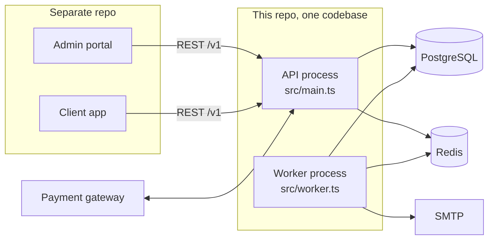
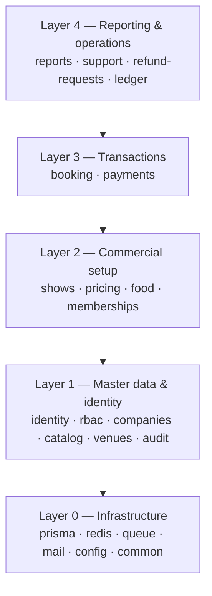
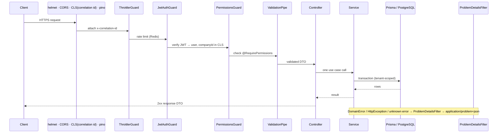

# Book My Ticket — Project Architecture

For: developers new to the codebase. Read this first, then [system-design](../system-design/system-design.md) (why things work the way they do) and [database-design](../database-design/database-design.md) (tables and constraints). Business rules live in the [domain specification](../domain-specification/domain-specification.md).

Status: **draft for review**. Sections marked *(exists)* describe code already in the repo; everything else is the plan.

## 1. The system in one minute

Book My Ticket is a multi-tenant movie-ticketing marketplace. Theater **companies** (tenants) run theaters through an **admin portal**; **customers** book seats, food and memberships through a **client app**. The platform collects all payments, keeps a commission and pays companies manually.

This repository is the **backend only**: a NestJS REST API plus a background worker. The frontend is a separate repo.



Architecture style: **modular monolith**. One deployable codebase split into business modules with enforced boundaries; two processes (API and worker) started from it.

## 2. Tech stack at a glance

Authoritative list: [tech-stack.md](../tech-stack/tech-stack.md). The parts you touch daily:

| You will use | For |
| --- | --- |
| NestJS 12, TypeScript strict, ESM | Framework. Imports of local files end in `.js` (`from './core.module.js'`) because of `nodenext` |
| Prisma 7 + PostgreSQL 17 | All data access. Generated client in `src/generated` (gitignored, run `pnpm prisma:generate`) |
| `class-validator` DTOs | Request validation (global `ValidationPipe`) |
| BullMQ | Background jobs, cron, run only in the worker |
| `nestjs-cls` + `nestjs-pino` | Correlation id and logging |
| Vitest | Tests |
| oxlint + Prettier + Husky | Lint and format on commit |

## 3. Repository layout

```
.
├── .claude/docs/            ← design docs (you are here)
├── docker/ docker-compose.yml   ← local Postgres, Redis, Mailpit
├── prisma/
│   ├── schema.prisma
│   ├── migrations/          ← SQL migrations (incl. hand-written constraints)
│   └── seed.ts
├── src/
│   ├── main.ts              ← API entry (exists)
│   ├── worker.ts            ← Worker entry (exists)
│   ├── app.module.ts        ← API root module (exists)
│   ├── core.module.ts       ← infra shared by API + worker (exists)
│   ├── config/              ← Zod env schema (exists)
│   ├── prisma/ redis/ mail/ health/   ← technical modules (exist)
│   ├── queue/               ← queue names, outbox dispatcher        (planned)
│   ├── common/              ← cross-cutting building blocks          (planned)
│   │   ├── auth/            ← decorators, guards (@Public, @RequirePermissions…)
│   │   ├── tenancy/         ← TenantContext (CLS)
│   │   ├── errors/          ← DomainError, Problem Details filter, error codes
│   │   ├── pagination/      ← keyset pagination DTOs + helper
│   │   ├── money/           ← paise/bps arithmetic, rounding
│   │   └── dto/ pipes/ interceptors/
│   ├── modules/             ← business modules                       (planned)
│   └── generated/           ← Prisma client (gitignored)
└── test/                    ← e2e tests
```

Rule of thumb: `common/` knows nothing about business concepts; `modules/` are business concepts; the existing technical folders (`prisma`, `redis`, `mail`) are infrastructure that modules consume.

## 4. Business modules

### 4.1 Catalogue

| Module | Owns (tables) | Responsibility |
| --- | --- | --- |
| `identity` | `users`, `refresh_tokens`, `auth_tokens` | Sign-up, login, refresh, password setup/reset, "me" |
| `rbac` | `roles`, `permissions`, `role_permissions`, `company_staff`, `staff_theaters`, `staff_invitations` | Permissions, roles, staff invites, theater scoping |
| `companies` | `companies` | Onboarding, commission rates, policies, status |
| `catalog` | `cities`, `movies` | Global movie catalog and cities (super admin) + public browse |
| `venues` | `theaters`, `screens`, `seat_categories`, `seats` | Theater → screen → seat layout |
| `shows` | `shows`, `show_prices` | Scheduling, overlap rules, cancelling a show |
| `pricing` | `tax_rates` | Tax rates; pure price calculator |
| `food` | `food_items` | Food menu |
| `memberships` | `membership_plans`, `company_membership_offers`, `customer_memberships` | Plans, opt-in, purchases, active-membership lookup |
| `booking` | `bookings`, `booking_seats`, `booking_food_lines`, `tickets`, `invoices` | Holds, checkout, confirmation, expiry, tickets, verify |
| `payments` | `payments`, `payment_webhook_events`, `refunds` | Gateway adapter, webhooks, executing refunds |
| `refund-requests` | `refund_requests` | Customer request, staff decision |
| `ledger` | `ledger_entries`, `settlements` | Recognition at show end, balances, settlements, dashboard figures |
| `support` | `support_tickets`, `support_ticket_messages`, `worker_assignments` | Help / maintenance / platform-request tickets, worker assignment |
| `audit` | `audit_logs` | Writing and viewing the audit trail |
| `reports` | *(reads only)* | Company sales report, super admin dashboard |
| `notifications` | `outbox_events` | Outbox dispatcher, email templates |

**One table is owned by exactly one module.** Other modules read it only through the owner's exported service.

### 4.2 Layers and dependency direction

Dependencies point **down only**. A module may import modules in a lower row, never the same row or above.



Cross-module communication, in order of preference:

1. **Call an exported service** of a lower layer (`booking` → `PricingService`).
2. **Publish an outbox event** when a lower or same-layer module must react (`payments` emits `payment.succeeded`; `booking` consumes it). This is what keeps `payments` from depending on `booking`.
3. Never import another module's internals, repositories or DTOs; only what its `index.ts` exports. A lint rule (`no-restricted-imports` on `modules/*/internal`) enforces it.

No `forwardRef()`. A circular dependency means a boundary is wrong — use an event instead.

### 4.3 Inside a module

Every module has the same shape, so you always know where to look:

```
modules/booking/
├── booking.module.ts
├── index.ts                         ← the public API: what other modules may import
├── controllers/                     ← ONE FOLDER PER SURFACE (who calls the endpoint)
│   ├── client/
│   │   └── client-bookings.controller.ts      → /v1/client/bookings
│   └── admin/
│       ├── admin-bookings.controller.ts       → /v1/admin/bookings
│       └── admin-tickets.controller.ts        → /v1/admin/tickets
├── services/                        ← COMMANDS: use cases that change state (shared by every surface)
│   ├── booking-checkout.service.ts            ← create hold + payment
│   ├── booking-confirmation.service.ts        ← confirm after payment (worker)
│   └── booking-expiry.service.ts              ← expire holds (worker)
├── queries/                         ← READS: one class per audience, each enforces its own scoping
│   ├── client-booking.queries.ts              ← "my" bookings (scoped by customer)
│   └── admin-booking.queries.ts               ← company bookings (scoped by company + theaters)
├── domain/                          ← pure TypeScript, no Nest, no Prisma
│   ├── booking-state.ts                       ← state machine
│   └── seat-claim.errors.ts
├── repositories/
│   └── seat-claim.repository.ts               ← the ONLY place with raw SQL for the seat claim
├── processors/
│   └── booking-expiry.processor.ts            ← BullMQ processor (registered in the worker)
├── dto/
│   ├── create-booking.dto.ts                  ← request
│   ├── client-booking.response.dto.ts         ← response per audience (never return Prisma models)
│   └── admin-booking.response.dto.ts
└── *.spec.ts                        ← next to the code they test
```

**Finding things.** Start from what you have:

| You have | Look in |
| --- | --- |
| A URL (`POST /v1/client/bookings`) | `modules/*/controllers/client/` → the controller names its service method |
| A permission code | `src/common/auth/permissions.ts`, then grep `@RequirePermissions(Permission.X)` |
| A table | The owning module (section 4.1), `services/` writes it, `queries/` reads it |
| A queue job or cron | `modules/*/processors/` |
| A business rule | `modules/*/domain/` |

The full lookup, endpoint by endpoint and service by service, is in [service-and-endpoint-map](service-and-endpoint-map.md).

**Services are organised by use case; surfaces appear only in controllers, queries and response DTOs.** A command such as `BookingCheckoutService.create()` is the same business operation whoever calls it, so there is one copy. What differs per audience is the **scope** and the **shape** of reads (a customer sees their own bookings; staff see their company's, limited to their theaters), so reads are separate classes per audience and a customer-scoped query can never be reused by mistake for an admin screen.

What goes where:

| Part | Does | Does not |
| --- | --- | --- |
| **Controller** | Route, Swagger decorators, guards/permissions, parse DTO, call **one** service method, return a response DTO | Business logic, Prisma, transactions |
| **Service (command)** | One use case per method (or per small service class); changes state. Orchestrates: authorise ownership, load, call domain functions, write in a transaction, record audit, write outbox | HTTP concepts (`Request`, status codes — throw `DomainError`s instead) |
| **Queries** | Read side, one class per audience (`ClientBookingQueries`, `AdminBookingQueries`): filtering, keyset pagination, response mapping, scoping by customer or by company + theaters. Never writes | State changes, side effects |
| **Domain** | Pure functions and state machines: pricing, transitions, QR payload | I/O of any kind |
| **Repository** | Only when raw SQL or a complex reusable query is needed (locking, seat map). Otherwise services use `PrismaService` directly | Business decisions |
| **Processor** | Consumes a BullMQ job; thin; delegates to a service | Logic of its own |
| **DTO** | Request validation and response shape | |

We do **not** add a repository layer on top of Prisma by default: Prisma already is one, and a generic wrapper only adds files. Add a repository when a query is reused or needs raw SQL.

## 5. Request lifecycle *(partly exists)*



Already wired in `main.ts` / `app.module.ts` / `core.module.ts`: helmet, CORS, `ValidationPipe`, CLS correlation id, pino, throttler with Redis storage, Swagger at `/docs`, Bull Board at `/queues`, health.

## 6. How to build a feature (the recipe)

Example: "company owner creates a show".

1. **Read the rules** in the domain spec; find the tables in database-design. If the schema needs to change, change `schema.prisma` and write the migration first (hand-written constraints included).
2. **Permission**: add `show.create` to the `Permission` constant in `common/auth/permissions.ts`; add it to the roles that should have it in the seed.
3. **DTOs**: `CreateShowDto` (validation + `@ApiProperty`) and `ShowResponseDto`.
4. **Domain**: pure function computing `ends_at`, `validateShowPrices(...)`, with unit tests.
5. **Service** `ShowsService.create(companyId, dto, actor)`:
   - verify the screen belongs to `companyId` (404 otherwise);
   - in one `prisma.$transaction`: insert show + prices, `audit.record(tx, …)`;
   - map the overlap exclusion violation to `DomainError('SHOW_OVERLAP')`.
6. **Controller** `admin-shows.controller.ts`: `@RequirePermissions('show.create')`, `@ApiTags('admin: shows')`, calls the service with `companyId` from `@CurrentCompany()`.
7. **Tests**: domain unit tests; service tests with `vitest-mock-extended`; an e2e test including the **cross-tenant** case (company B cannot see company A's screen: expect 404).
8. Run `pnpm lint && pnpm format:check && pnpm test && pnpm build` before pushing (Husky runs lint-staged on commit; CI runs everything).

## 7. Conventions

### 7.1 Code

| Topic | Rule |
| --- | --- |
| Files | `kebab-case.type.ts` (`create-show.dto.ts`, `shows.service.ts`); one class per file; specs next to the file |
| Classes | `PascalCase` with role suffix (`ShowsService`, `AdminShowsController`) |
| Imports | Local imports end in `.js`; import other modules only from their `index.ts` |
| Types | No `any`. Parse `unknown` with DTO/Zod. Response DTOs are classes (Swagger plugin picks them up) |
| Config | Read through `ConfigService<Env, true>`; never `process.env` in feature code; add new variables to the Zod schema and `.env.example` |
| Time | Store and compute in UTC; use the DB `now()` for hold and expiry comparisons |
| Money | `number` of paise and bps; use `common/money` helpers; never floats |
| IDs | UUID strings; validate with `@IsUUID()` / `ParseUUIDPipe` |
| Logging | Inject `PinoLogger`; log ids, not PII; no `console.log` |
| Comments | Explain *why* only; the code says *what* |

### 7.2 Errors

- Services throw `DomainError(code, message, status?)` for business failures (`SEAT_UNAVAILABLE`, `SHOW_OVERLAP`, `INVALID_STATE_TRANSITION`); Nest `HttpException`s for plain cases (`NotFoundException`).
- One global filter turns anything into RFC 7807 `application/problem+json` with a stable `code` (details in [api-design](../api-design/api-design.md)).
- Never leak stack traces, SQL or Prisma messages; unknown errors become `500 INTERNAL` plus a log line carrying the correlation id.
- Map Prisma/Postgres errors where they are understood (`P2002` unique, `23505` seat claim, `23P01` exclusion) to domain errors in the service that knows the meaning.

### 7.3 Transactions

- A use case that changes more than one row runs in **one** `prisma.$transaction(async tx => …)`; pass `tx` down to helpers (`audit.record(tx, …)`, `outbox.add(tx, …)`).
- Keep transactions short: no network calls (gateway, email) inside them. Write an outbox event instead.
- Anything that can run twice (jobs, webhooks) must be idempotent: check state inside the transaction.

### 7.4 Testing

| Level | What | Tools | DB |
| --- | --- | --- | --- |
| Unit | Domain functions, state machines, price calculator | Vitest | none |
| Service | Use cases with Prisma mocked | Vitest + `vitest-mock-extended` | mock |
| Integration | **Concurrency and constraints**: two buyers, one seat; overlapping shows; ledger idempotency | Vitest + real Postgres | `book_my_ticket_test` (Compose), reset per test file |
| E2E | HTTP through guards and pipes | `supertest` | test DB |

Mandatory tests: booking race (N parallel claims for the same seat → exactly one wins), price snapshot immutability, every admin endpoint's cross-tenant 404, webhook replay, ledger recognised once.

### 7.5 Git and CI

Conventional commits (`feat:`, `fix:`, `docs:`…). Small PRs per module slice. CI (GitHub Actions): install → lint → format check → build → unit → integration/e2e against service containers.

## 8. Running it locally *(exists)*

```bash
pnpm install
cp .env.example .env
pnpm infra:up            # Postgres :5433, Redis :6379, Mailpit UI :8025
pnpm prisma:generate
pnpm prisma:migrate
pnpm certs               # once, needs mkcert; add bookmyticket.test to /etc/hosts
pnpm start:dev           # API   → https://bookmyticket.test:3000/docs
pnpm start:worker        # worker (separate terminal)
```

See [README](../../../README.md) for HTTPS and URL details.

## 9. Delivery plan

Build in vertical slices so each milestone is demoable and testable. Nothing starts until these docs are approved.

| # | Milestone | Contents | Exit check |
| --- | --- | --- | --- |
| 0 | **Foundations** | `common/` (errors, pagination, money, auth decorators), Problem Details filter, env additions, CI | Lint/test/build green; error format e2e test |
| 1 | **Identity & RBAC** | Schema for users/roles/permissions/refresh tokens, seed, login/refresh, `PermissionsGuard`, `/me` | Auth e2e, permission matrix test |
| 2 | **Companies & staff** | Company onboarding (super admin), password-setup email, staff invites, audit log | Onboard → email in Mailpit → login |
| 3 | **Venues & catalog** | Cities, movies, theaters, screens, seats, categories | Tenant isolation tests |
| 4 | **Shows & pricing** | Shows, prices, overlap constraint, tax rates, price calculator | Overlap rejected by DB; calculator property tests |
| 5 | **Booking core** | Seat map, hold, expiry, mock gateway, webhook, confirmation, ticket + QR, outbox | **Race test passes**; hold expires |
| 6 | **Food & memberships** | Menu, slots, plans, opt-in, purchase, discount at checkout | Snapshot immutability test |
| 7 | **Refunds & cancellations** | Refund requests, staff decision, gateway refund, show cancellation | State machine tests |
| 8 | **Ledger & settlements** | Recognition job, balances, settlements, dashboard, company report | Ledger idempotency + reconciliation test |
| 9 | **Support** | Three ticket types, routing, worker assignment | Routing tests |
| 10 | **Hardening** | k6 load on a hot show, `EXPLAIN` review, security pass, docs polish | Targets in system-design §1 met |

## 10. Glossary

| Term | Meaning |
| --- | --- |
| Tenant / company | A theater business; the isolation boundary |
| Hold | A seat reserved for 10 minutes while the customer pays (`booking_seats.status = HELD`) |
| Snapshot | Price/rate values copied onto a booking so later changes don't affect it |
| Paise / bps | Minor currency unit (1/100 ₹) / basis point (1/100 %) |
| Ledger | Append-only record of money owed to companies and platform income |
| Settlement | A manual bank payout to a company, recorded by the super admin |
| Outbox | Table of events written in the same transaction as a state change, then dispatched to queues |
| Recognition | Writing a booking's commission and company share to the ledger after the show ends |
| Surface | One of the API audiences: public, client, admin, platform |
