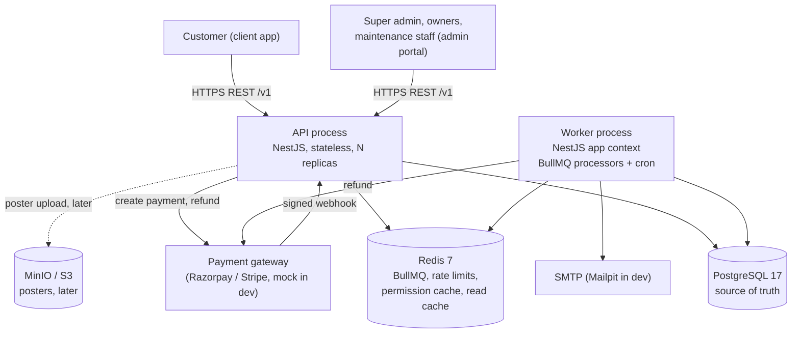
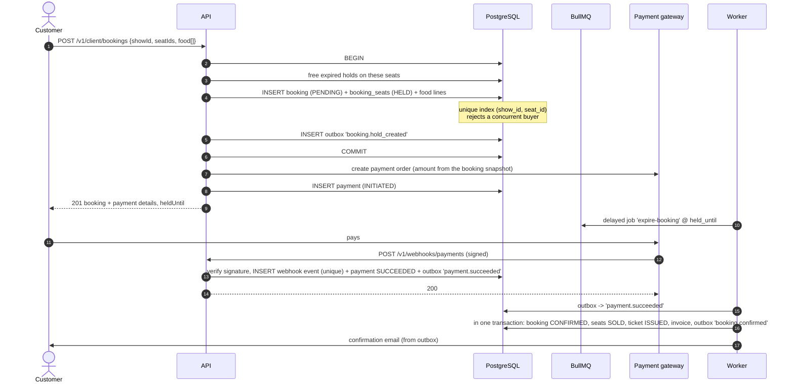
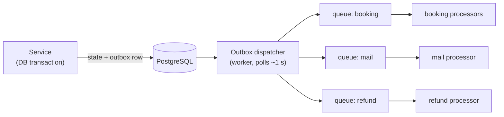
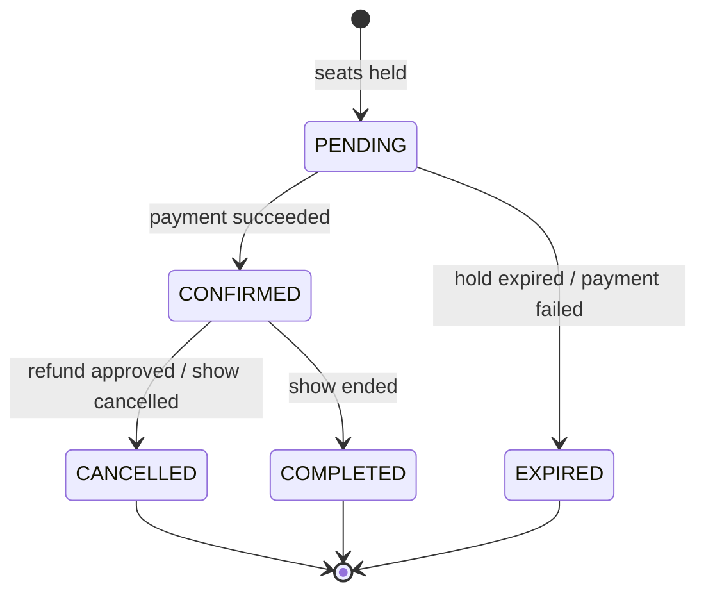
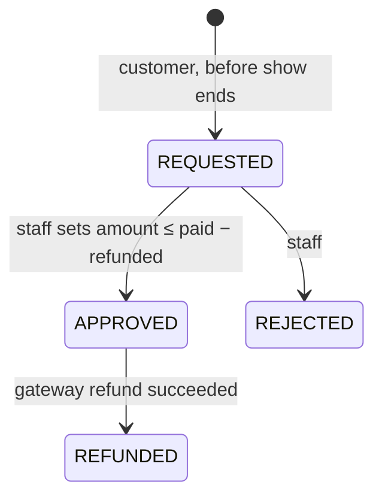
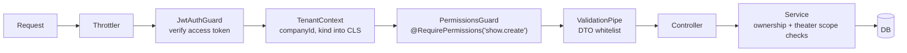

# Book My Ticket — System Design

Status: **approved decisions applied** (ADR-002, ledger rules, outbox, composite tenant FKs). Domain rules come from the [domain specification](../domain-specification/domain-specification.md); the stack is fixed in [tech-stack](../tech-stack/tech-stack.md). Table and column names refer to [database-design](../database-design/database-design.md).

## 1. Requirements that drive the design

### Functional (summary)

Multi-tenant marketplace; two surfaces (admin portal, client app); seat booking with a 10-minute hold; memberships per company; manual refunds decided by staff; platform-collected money with delayed commission; three kinds of support tickets; audit log; email notifications.

### Non-functional

| Concern | Target for v1 | Design consequence |
| --- | --- | --- |
| **Correctness of seat inventory** | A seat is never sold twice, under any concurrency | Database unique index is the lock (section 4) |
| **Correctness of money** | Totals reproducible forever; no lost or double entries | Integer minor units, snapshots, append-only ledger, idempotent jobs (section 7) |
| **Tenant isolation** | A company never reads or writes another's data | `company_id` everywhere, composite FKs, tenant from token only (section 8) |
| **Availability** | Single region; a worker crash must not lose emails or leave holds stuck | Outbox + sweepers (section 5) |
| **Performance** | Seat map and booking p95 < 300 ms at ~50 concurrent buyers on one hot show | Short transactions, index-only lookups, no cross-network lock round trips |
| **Scale** | ~100 companies, ~500 theaters, ~1k bookings/hour peak (a big release is the spike) | One Postgres, one Redis, N stateless API pods, M workers. No microservices, no sharding |
| **Security** | OWASP API Top 10, PII minimised | Section 9 |
| **Operability** | A new dev can trace any request end to end | Correlation ID on every log line and job (section 10) |

Explicitly **not** designed for: multi-region, multi-currency, millions of concurrent users. The design leaves doors open (stateless API, UUID keys) without paying for them now.

## 2. System context and containers



Two deployable processes from one codebase and one image:

| Process | Entry | Runs |
| --- | --- | --- |
| API | `src/main.ts` | HTTP, Swagger, Bull Board, health |
| Worker | `src/worker.ts` | BullMQ processors, cron (repeatable jobs), outbox dispatcher |

They share `CoreModule` (config, logging, CLS, Prisma, Redis, queues, mail). The API never does slow or retryable work inline; it commits to Postgres and lets the worker do the rest.

## 3. Pattern catalogue

Every pattern below is in the design for a concrete reason. If a feature does not need one, don't add it.

| Pattern | Where | Why |
| --- | --- | --- |
| **Modular monolith** (ADR-001) | Whole app | One deploy, strong module boundaries, transactions across modules where money needs them |
| **Layered modules**: controller → service → Prisma | Each module | Controllers translate HTTP; services hold use-case logic; Prisma is the repository |
| **Pure domain functions** | `pricing`, state machines, QR payload | Business rules with no I/O are trivially unit-testable |
| **State machine** | Booking, refund request, ticket, support ticket | Illegal transitions are impossible by construction (section 6) |
| **Constraint-as-lock** (ADR-002) | Seat claim | The DB serialises conflicting inserts; no distributed lock |
| **Snapshot** (ADR-003) | Booking prices/rates | Past bookings are immutable |
| **Append-only ledger** (ADR-004) | Money | Auditable, reproducible balances |
| **Transactional outbox** (ADR-005) | Side effects (email, booking confirmation after payment, refunds) | A committed state change always results in its follow-up work, even after a crash |
| **Idempotent consumers** | Webhooks, jobs, ledger recognition | At-least-once delivery without double effects |
| **Inbox table** | `payment_webhook_events` | Replayed webhooks are no-ops |
| **Sweeper (reconciliation) jobs** | Hold expiry, show completion, outbox, ledger recognition | Safety net for missed events; correctness never relies on a single message |
| **Gateway / adapter** | `PaymentGateway`, `MailService`, `QrSigner` | Swap mock ↔ real providers without touching business code |
| **Policy guard (RBAC)** | `@RequirePermissions()` + guards | Permission checked on every action, server-side |
| **Tenant context** (CLS) | Request-scoped | `companyId` flows implicitly, never from client input |
| **Problem Details errors** | Global filter | One error shape across the API |
| **Keyset pagination** | All collections | Stable and fast on large tables |

Deliberately **not** used: CQRS/event sourcing (a ledger gives us the audit benefit at a fraction of the cost), microservices, a message broker beyond BullMQ, Postgres RLS (ADR-006), GraphQL, a generic repository layer over Prisma.

## 4. Booking: the critical path

### 4.1 Sequence



### 4.2 Claiming seats: the rule that cannot break

1. The booking service validates the request (≤ 10 seats, show `SCHEDULED` and not started, seats belong to the show's screen and are active, food items belong to the company/theater, slot is valid).
2. It runs **one transaction** (database-design 7.2): insert `booking_seats` with `ON CONFLICT DO NOTHING`; for any seat that conflicted, release the conflicting hold **if it has expired**, then retry the insert once, all in the same transaction. If a seat is still missing, it is live-held or sold: the service rolls back and returns **409 `SEAT_UNAVAILABLE`** listing those seats.
3. No Redis lock and no `FOR UPDATE`. An expired hold can never block a seat, with or without the sweeper. Two buyers of the same live seat: one wins, one gets a clear 409.
4. A customer may have one `PENDING` booking per show (partial unique index); a new attempt must reuse or cancel the existing one.

Why Postgres and not Redis `SET NX` for holds: see ADR-002. Short version: Redis would be a second source of truth that has to be reconciled with Postgres on every failure mode; the DB constraint is already required as the final guard, so the Redis layer adds latency and states without removing the need for it.

### 4.3 Price calculation

Pure function in `modules/pricing/pricing.calculator.ts`; no I/O; inputs are plain data, output is the snapshot written to the booking. Order of operations, always:

```
for each seat:   list = show price for its category
                 discount = round_half_up(list × membership.discount_bps / 10000)   // seats only
                 net = list − discount
                 tax = round_half_up(net × TICKET tax bps / 10000)
for each food:   line = unit_price × qty ; tax = round_half_up(line × FOOD tax bps / 10000)
total = Σ net + Σ food + Σ tax
```

Rounding is per line, half-up, in one helper (`common/money.ts`); totals are sums of rounded lines so the invoice always adds up. The calculator is exhaustively unit-tested with property tests (total equals the sum of lines; discount never exceeds list).

### 4.4 Payment edge cases

| Situation | Behaviour |
| --- | --- |
| Payment fails | `payment.failed` → booking `EXPIRED`, seats `RELEASED` |
| Hold expires before payment | Expiry job: booking `EXPIRED`, seats `RELEASED`; payment marked failed on the gateway where possible |
| **Payment succeeds after hold expired** | Confirmation handler checks all seats are still `HELD` by this booking. If a seat was released and re-sold, booking is not confirmed, an automatic **full refund** is issued and the customer is emailed. If the seats are still free, they are re-claimed and the booking is confirmed (the customer paid in good faith) |
| Webhook delivered twice / out of order | `UNIQUE (provider, event_id)` makes the second delivery a no-op; handlers check current state before transitioning |
| API crashes after gateway order created but before saving payment | Reconciliation job lists gateway orders for `PENDING` bookings and fixes up state; the webhook alone is also sufficient |
| Webhook never arrives | Sweeper checks `INITIATED` payments past `held_until` against the gateway |

The client never decides success: only a verified webhook (or the reconciliation job) changes a payment to `SUCCEEDED`.

## 5. Asynchronous work

### 5.1 Transactional outbox

State changes that need follow-up work write an `outbox_events` row **in the same transaction**. A dispatcher in the worker claims rows with `FOR UPDATE SKIP LOCKED`, enqueues the matching BullMQ job (with a deterministic `jobId`), and marks them processed. Delivery is at-least-once; consumers are idempotent.



This also removes the module coupling that would otherwise exist: `payments` emits `payment.succeeded` and does not know `booking` exists; `booking` subscribes.

### 5.2 Queues and cron jobs

| Name | Trigger | Does | Idempotency |
| --- | --- | --- | --- |
| `booking:expire` | Delayed job at `held_until` + sweeper every minute | `PENDING` past `held_until` → `EXPIRED`, seats `RELEASED` | State check inside transaction |
| `booking:confirm` | `payment.succeeded` | Confirm booking, issue ticket and invoice | Only acts on `PENDING` |
| `show:complete` | Cron every minute | Shows with `ends_at <= now()` → `COMPLETED`; `CONFIRMED` bookings → `COMPLETED` | Status guard |
| `ledger:recognise` | After `show:complete` + sweeper every 5 min | Writes ledger entries (section 7) | Unique `(booking_id, entry_type)` + `ledger_recognised_at` |
| `show:cancel` | Company cancels a show | Cancels bookings, creates full refunds, queues emails | Per-booking state guard |
| `refund:execute` | Approved refund request, or cancelled show | Calls gateway, writes `refunds`, updates `bookings.refunded_amount` | Gateway idempotency key = refund id |
| `mail:send` | Outbox | Renders template and sends | Dedupe key = event id |
| `housekeeping` | Daily cron | Purge expired `idempotency_keys`, `auth_tokens`, `refresh_tokens` | Naturally idempotent |

Retry policy: exponential backoff, 5 attempts, then the job stays in Bull Board's failed set (`/queues`) and raises a log at `error` level. A failed job never silently disappears.

## 6. State machines

Each machine is implemented once as a pure `canTransition(from, to)` + `transition()` helper in the module's `domain/` folder, and the service refuses anything else (409 `INVALID_STATE_TRANSITION`).

### Booking



### Refund request



Approval also moves the booking to `CANCELLED` and, if the show has not started, releases its seats. A request after the show has ended is rejected by the service (`show.ends_at <= now()`).

### Ticket

`ISSUED → USED` (atomic `UPDATE ... WHERE status = 'ISSUED'`, rows affected = 0 means already used) and `ISSUED → VOID` (booking cancelled).

## 7. Money flow and the ledger

### 7.1 Principles

- Customer payments sit in `payments`; **nothing is income until the show ends**.
- Refunds before the show reduce what is pending. No refunds after the show, so recognised commission is never reversed (a mistake is fixed with an `ADJUSTMENT` entry, never an edit).
- All rates come from the booking snapshot.

### 7.2 Recognition at show completion

Rules (confirmed): commission applies to **tickets and food**, calculated on the **pre-tax** amount; the only discount in v1 is the membership discount, which applies to tickets only, so the ticket commission base is the post-discount price. Tax is passed through to the company. On a partial refund the company keeps the remainder and commission is calculated on it at completion.

For each booking with `ledger_recognised_at IS NULL` whose show is `COMPLETED` and which is `COMPLETED`, or `CANCELLED` with `paid_amount − refunded_amount > 0`:

```
retained = paid_amount − refunded_amount          // = paid_amount for an untouched booking

// Split `retained` across the four components in proportion to the booking's
// own amounts, using largest-remainder rounding so the parts sum exactly:
//   ticket_base = seats_subtotal − discount_amount     (pre-tax, post-discount)
//   ticket_tax  = Σ seat tax
//   food_base   = food_subtotal                         (pre-tax)
//   food_tax    = Σ food tax
// For an untouched booking each part equals its own amount.

ticket_commission = round_half_up(ticket_base_part × commission_bps / 10000)
food_commission   = round_half_up(food_base_part   × commission_bps / 10000)

COMPANY_PAYABLE  +(ticket_base_part − ticket_commission + ticket_tax_part)   TICKET_PAYOUT
PLATFORM_INCOME  +ticket_commission                                          TICKET_COMMISSION
COMPANY_PAYABLE  +(food_base_part − food_commission + food_tax_part)         FOOD_PAYOUT
PLATFORM_INCOME  +food_commission                                            FOOD_COMMISSION
```

Worked example: 2 seats at ₹250 with a 10% membership discount → ticket_base ₹450; food ₹240; commission rate 10% → ticket commission ₹45, food commission ₹24; tax 18%/5% passes through. All entries for a booking are written in one transaction with `ledger_recognised_at = now()` set last, so the job is idempotent. Components sum to `retained` exactly; the booking's commission is therefore never on tax and never on money that was refunded.

### 7.3 Memberships and registration

- Membership payment succeeded → immediately: `MEMBERSHIP_COMMISSION` to platform and `MEMBERSHIP_PAYOUT` (price + tax − commission) to the company. Example from the spec: ₹1,000 plan at 10% → platform ₹100, company ₹900 (tax shown separately).
- Registration fee → `REGISTRATION_FEE` platform entry when the super admin onboards a company.

### 7.4 Settlements

The super admin sees each company's payable balance (`SUM` over `ledger_entries`), pays by bank transfer, and records a `settlement` + negative `SETTLEMENT` entry in one transaction guarded by `FOR UPDATE` on the company row (database-design 7.4). Overpaying (amount > balance) is rejected.

### 7.5 Dashboard definitions

| Figure | Definition |
| --- | --- |
| Platform income | Σ `PLATFORM_INCOME` ledger entries |
| Pending (not yet earned) | Σ (`paid_amount − refunded_amount`) of `CONFIRMED` bookings |
| Payable to companies | Σ `COMPANY_PAYABLE` ledger entries |
| Companies registered / bookings | Counts |

## 8. Identity, tenancy and authorization

### 8.1 Who is who

| Role | `users.kind` | Company | Gets permissions from |
| --- | --- | --- | --- |
| Super admin | `SUPER_ADMIN` | none (platform) | Implicit: all `/platform/*` routes |
| Company owner | `STAFF` | one | System role `COMPANY_OWNER` (all company permissions) |
| Maintenance staff | `STAFF` | one + theater list | System role `MAINTENANCE_STAFF` |
| Client | `CLIENT` | none | Own data only |

### 8.2 Request authorization pipeline



- **Token**: access JWT (15 min) carries `sub`, `kind`, `companyId` (for staff). It does **not** carry permissions.
- **Permissions** are loaded per user and cached in Redis (60 s TTL, evicted when roles change), so revoking a role takes effect within a minute and tokens stay small.
- **Guards** are declarative; **services** enforce what guards cannot: that the target row belongs to the caller's company, and that maintenance staff act only on their assigned theaters. Every tenant-table query includes `company_id`.
- Super admin routes live under `/v1/platform/*` and are guarded by `@PlatformOnly()`; a company token can never reach them.
- Missing or foreign resource → **404**, never 403 (do not leak existence).

### 8.3 Auth flows

| Flow | Notes |
| --- | --- |
| Client sign-up / login | Email + password, argon2id. Rate limited per IP and per email |
| Company owner onboarding | Super admin creates company + owner (`INVITED`); an emailed one-time token (`auth_tokens`, `SET_PASSWORD`, 72 h) sets the password |
| Staff invite | Owner creates `staff_invitations`; emailed link; acceptance creates the user, `company_staff` and `staff_theaters` in one transaction |
| Refresh | Rotating refresh token in an `HttpOnly; Secure; SameSite=Lax` cookie scoped to `/v1/auth`; reuse of a rotated token revokes the whole family |
| Logout | Revokes the family |

## 9. Security checklist

| Area | Control |
| --- | --- |
| Passwords | argon2id; minimum length 10; no composition rules; breached-password check later |
| Transport | HTTPS everywhere; `helmet`; CORS limited to `FRONTEND_ORIGIN` |
| Input | Global `ValidationPipe` (`whitelist`, `forbidNonWhitelisted`, `transform`); DTO for every body, query and param |
| Injection | Prisma parameterised queries; raw SQL only via tagged `$queryRaw` templates, never string concatenation |
| Rate limiting | `@nestjs/throttler` with Redis store: global default, stricter on `/auth/*` and booking creation |
| Webhooks | Signature verified over the raw body before any parsing; timestamp tolerance; event-id dedupe |
| Tickets | QR signed with **Ed25519** (private key in env/secret store; verifiers need only the public key — keeps the later third-party verifier simple); payload: ticket id, booking id, show id, nonce; the signature proves origin, the DB `status` proves single use |
| Secrets | Only through validated env; nothing in code or logs; `pino` redacts `authorization`, `password`, `token` fields |
| PII | Store email, name, phone only. Gate workers: employee ID only. No card data ever touches the API (gateway-hosted checkout) |
| Audit | Every admin mutation writes `audit_logs` in the same transaction (actor, module, action, before, after, correlation id) via `AuditService.record(tx, …)` |
| Abuse | One pending booking per customer per show; max 10 seats; hold time fixed server-side |
| Enumeration | UUIDv7 ids; 404 on foreign resources; generic login error |
| Dependencies | `pnpm audit` in CI |

## 10. Observability and operations

| Concern | Approach |
| --- | --- |
| Correlation | `nestjs-cls` creates/accepts `x-correlation-id` per request; `nestjs-pino` stamps every log line; the id is copied into outbox payloads and job data, so one search follows a booking from HTTP through the worker |
| Logs | JSON in prod, pretty in dev; levels from `LOG_LEVEL` |
| Health | `GET /health` (Postgres + Redis); used for liveness/readiness |
| Queues | Bull Board at `/queues` (restrict to super admin before any shared environment) |
| Metrics / traces | `@nestjs/observe`; business metrics worth alerting on: holds expiring per minute, outbox lag, failed jobs, 409 `SEAT_UNAVAILABLE` rate, payments `INITIATED` older than 15 min |
| Graceful shutdown | `enableShutdownHooks()`; workers finish the active job before exit |
| Config | One Zod schema in `src/config/env.ts`; boot fails on invalid config |
| Environments | Local: Docker Compose (Postgres 5433, Redis, Mailpit). CI: same services. Prod: managed Postgres + Redis (details out of scope here) |
| Backups | Managed Postgres PITR; money tables are the restore priority |

## 11. Failure modes

| Failure | Effect | Mitigation |
| --- | --- | --- |
| API pod dies mid-request | Transaction rolls back; no partial booking | Client retries with the same `Idempotency-Key` |
| Worker dies mid-job | Job is retried by BullMQ | Idempotent handlers; outbox row stays unprocessed |
| Redis down | No rate limiting, no queue enqueue, no permission cache | Health check fails; permission cache falls back to DB; outbox keeps events safe in Postgres until Redis returns. Bookings can still be **created** (Postgres only) but confirmation waits |
| Postgres down | API unavailable | Nothing is acknowledged that is not committed |
| Gateway down | Cannot create orders | 502 `PAYMENT_PROVIDER_UNAVAILABLE`; the hold is released immediately (booking `EXPIRED`) so seats are not stuck |
| Duplicate / delayed webhooks | None | Inbox unique key, state checks |
| Clock skew between pods | Hold boundaries off by ms | All time comparisons use the database's `now()`, not the app clock |
| Hot show (release day) | Many 409s, row contention on one index range | Inserts touch different `(show, seat)` keys, so contention exists only on genuinely contested seats; seat map reads may be cached 1–2 s in Redis if needed (stale reads are safe, the claim is the authority) |

## 12. Architecture decision records

### ADR-001 — Modular monolith

- **Context**: 15+ business modules, one small team, strong transactional needs (booking, ledger).
- **Decision**: One NestJS codebase, two processes (API, worker), strict module boundaries.
- **Alternatives**: Microservices (booking/payments/ledger split) — network boundaries and distributed transactions for no scale benefit now.
- **Consequences**: + simple deploys, local transactions, easy refactors. − discipline needed to keep modules decoupled (enforced by the dependency rules in project-architecture 4.3 and a lint/import check); the worker/API split is the natural future seam.

### ADR-002 — Postgres is the only authority for seat holds (approved)

- **Context**: The tech-stack lists Redis for "seat holds". A hold must be exclusive, time-limited and survive crashes; a sale must be exclusive forever.
- **Decision** (confirmed): Holds are `booking_seats` rows with `status = HELD` and `held_until`, protected by a partial unique index. Expiry is lazy (seat-map reads ignore expired holds; the claim releases an expired conflicting hold inside its own transaction) plus eager (delayed job and a per-minute sweep job). Redis is used for rate limiting, queues, permission cache and optional seat-map read cache — not as lock authority.
- **Alternatives**: (a) Redis `SET NX PX` hold + DB constraint at purchase — two systems to keep consistent, and a Redis flush would free every hold; (b) pessimistic `SELECT … FOR UPDATE` on a `show_seats` table pre-populated per show — large write amplification at show creation (20M+ rows per year) and serialises more than necessary; (c) advisory locks — extra moving part, same guarantee.
- **Consequences**: + one consistency domain; atomic with booking creation; survives Redis loss. − hold-heavy traffic hits Postgres (acceptable at the target scale; revisit with measurements). Deviates from the tech-stack wording; approved, and `tech-stack.md` should read "Redis: caching, rate limiting, BullMQ".

### ADR-003 — Money as integer paise; rates as basis points; snapshots on the booking

- **Context**: Rounding and rate changes must never alter past bookings.
- **Decision**: `int` paise, `int` bps, copied onto booking lines at purchase, one rounding helper.
- **Alternatives**: `numeric(12,2)` (Prisma `Decimal` is workable but easy to misuse across JSON boundaries); floats (rejected).
- **Consequences**: + exact arithmetic, trivial JSON. − `int4` caps one amount at ~₹21 million, far above any single ticket order; aggregates use SQL `SUM` returning `bigint`.

### ADR-004 — Append-only ledger for payouts and income

- **Context**: Super admin must pay companies manually and trust the numbers; audits must reproduce them.
- **Decision**: Signed entries in `ledger_entries`; balances are sums; corrections are `ADJUSTMENT` entries; triggers forbid `UPDATE`/`DELETE`.
- **Alternatives**: A mutable `balance` column per company (loses history, races) — rejected.
- **Consequences**: + auditability, idempotent recognition. − balances are aggregates (index-only scan keeps them fast; a cached balance can be added if needed).

### ADR-005 — Transactional outbox + BullMQ (approved)

- **Context**: Confirmation emails, ticket issuance and refunds must follow committed state, without a dual-write gap.
- **Decision**: Write events to `outbox_events` in the business transaction; the worker dispatches to BullMQ.
- **Alternatives**: Enqueue directly after commit (a crash between commit and enqueue loses the job; needs sweepers for every case); in-process event emitter (lost on crash, couples modules).
- **Consequences**: + no lost work, decoupled modules. − ~1 s extra latency; one more table and poller (small).

### ADR-006 — Tenant isolation in the application, not Row-Level Security (composite tenant FKs approved)

- **Context**: Every tenant query must be scoped.
- **Decision**: `company_id` on every tenant table, composite FKs for hierarchy integrity, tenant taken from the authenticated principal only, mandatory cross-tenant tests.
- **Alternatives**: Postgres RLS via `SET LOCAL app.company_id` per transaction — strongest isolation, but needs a transaction wrapper for every query through Prisma and complicates the pool and admin/worker access.
- **Consequences**: + simple, debuggable. − relies on code discipline and tests; revisit RLS if more teams touch the data layer.

### ADR-007 — Permission-based RBAC with seeded roles

- **Context**: Spec requires permission-based access; owners hold all company permissions; staff invited with a role.
- **Decision**: `permissions` (from a code constant), `roles` (system roles seeded now; schema allows company roles later), Nest guards, ownership checks in services.
- **Alternatives**: CASL (per tech-stack, only if rules grow); plain role checks (not what the spec asks for).
- **Consequences**: + the admin portal can hide menus from the same permission list (`GET /v1/admin/me` returns it). − adding a permission requires a seed/migration.

### ADR-008 — REST, URI-versioned, split by surface

- **Decision**: `/v1/public`, `/v1/client`, `/v1/admin`, `/v1/platform`, `/v1/auth`, `/v1/webhooks` (see [api-design](../api-design/api-design.md)).
- **Alternatives**: GraphQL (extra complexity for two known clients); one flat API (permission leaks, unclear ownership).
- **Consequences**: + each surface has its own auth rules and docs tag. − a few similar controllers per module (`admin-*`, `client-*`).

### ADR-009 — UUID v7 keys

- **Decision**: UUID v7 PKs generated by Prisma.
- **Alternatives**: `bigserial` (enumerable, awkward in URLs, needs a second public id); UUID v4 (random index inserts).
- **Consequences**: + time-ordered, safe to expose. − 16-byte keys (acceptable).

## 13. Risks

| Risk | Likelihood | Impact | Mitigation |
| --- | --- | --- | --- |
| Rules in the spec are ambiguous for money edge cases | High | High | Decisions are recorded in the [docs index](../README.md#decisions); remaining assumptions are small and listed there |
| Partial indexes/exclusion constraints lost when someone regenerates migrations | Medium | High | They live in migration SQL; a CI test asserts they exist (queries `pg_indexes` / `pg_constraint`) |
| Module coupling creeps in | Medium | Medium | Import-boundary check in lint; outbox events between modules |
| Hot-show load exceeds one Postgres | Low | Medium | Measure first (k6 test is part of the booking milestone); read cache for seat map; pooler |
| Gateway behaviour differs from mock | Medium | Medium | Mock implements the same interface and failure modes (delay, duplicate webhook, late success) |
